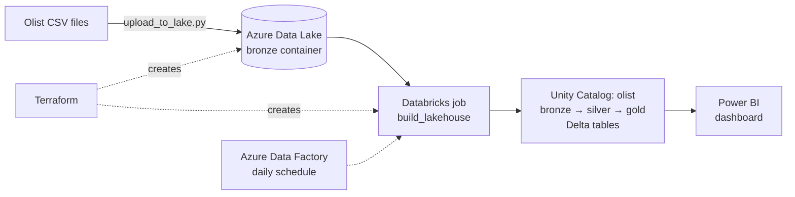

# E-commerce Data Pipeline

End-to-end data platform for a Brazilian e-commerce marketplace: ingestion, data quality, dimensional modeling, Azure Databricks and dbt, running every day as a **live store**.

> **Status:** in active development. See the [roadmap](#roadmap).

## What this project does

The [Olist dataset](https://www.kaggle.com/datasets/olistbr/brazilian-ecommerce) contains ~100,000 real orders from a Brazilian marketplace, spread across 9 related tables (orders, customers, products, sellers, payments, reviews, geolocation...).

Instead of analysing it as a static snapshot from 2016–2018, this pipeline **replays the data as if the store were operating today**:

- **Historical backfill:** past orders are loaded once.
- **Daily incremental loads:** new orders "arrive" every day and only the new data is processed.
- **Quality checks** run on every load before data reaches the analytics layer.

## Architecture



The same SQL models also run locally on DuckDB (`pipeline/build_*.py`), so every change can be tested on a laptop before it reaches the cloud.

## Tech stack

| Area | Tools |
|---|---|
| Languages | Python, SQL |
| Local warehouse | DuckDB |
| Cloud platform | Microsoft Azure (Data Lake Storage Gen2, Databricks, Unity Catalog) |
| Infrastructure as code | Terraform |
| Transformations | dbt on Databricks (bronze / silver / gold layers) |
| Orchestration | Azure Data Factory |
| CI | GitHub Actions (automated tests) |
| Consumption | Power BI |

## Roadmap

- [x] **Phase 1 — Ingestion:** load the raw CSV files into a local database and answer the first business questions with SQL.
- [x] **Phase 2 — Data quality:** detect and handle nulls, duplicates and broken records with automated checks.
- [x] **Phase 3 — Dimensional modeling:** star schema with fact and dimension tables.
- [x] **Phase 4 — Cloud:** the whole platform on Azure, created with Terraform: data lake, Databricks, keyless access and a job that rebuilds every layer.
- [ ] **Phase 5 — dbt:** layered transformations with tests and documentation.
- [ ] **Phase 6 — Automation:** one-command pipeline with logging, error handling and a daily schedule in Azure Data Factory.
- [ ] **Phase 7 — Delivery:** Power BI dashboard and full documentation.

## Data profiling findings

Before building anything, the raw data was profiled with SQL ([queries](sql/exploration/) · [source data model](docs/source_data_model.md)). Key findings that shape the next phases:

- **`customer_id` is not a customer.** It is one per order; the real person is `customer_unique_id` (96,096 people, ~3,345 orders from repeat customers).
- **Grain matters.** `order_items` has one row per product (112,650 rows for 98,666 orders) and `geolocation` has ~52 rows per zip code, so careless joins multiply rows.
- **Data quality issues.** 775 orders have no items, 8 delivered orders have no delivery date and 6 canceled orders have one (flagged in Phase 2).
- **Incomplete months.** The first and last months are almost empty; complete data runs from 2017-01 to 2018-08, the candidate range for the live-store replay.

## Data quality

The `silver` layer applies the decisions in [docs/data_quality_decisions.md](docs/data_quality_decisions.md): no row is deleted silently; issues are fixed when the fix is safe or flagged with a column otherwise.

After every build, `pipeline/check_quality.py` runs 20 automated checks (unique keys, every relationship exists, no impossible dates or prices, joins that do not multiply rows) and stops the pipeline if any fails.

## Star schema

The `gold` layer is a star schema with two fact tables (`fact_order_items`, one row per product sold, and `fact_orders`, one row per order) and four dimensions (customers, products, sellers and dates). Grain, diagram and design decisions: [docs/gold_model.md](docs/gold_model.md).

**First result:** late deliveries hurt reviews. Orders delivered on time average **4.29** stars; late orders average **2.57**.

## Cloud platform (Azure)

All the Azure infrastructure is code ([infra/main.tf](infra/main.tf)): `terraform apply` creates it and `terraform destroy` removes it.

- **Data lake:** ADLS Gen2 storage account with a `bronze` container (raw CSV files) and a `lakehouse` container where Unity Catalog stores the silver and gold Delta tables.
- **Keyless access:** Databricks reaches the lake through a managed identity (Access Connector) with the *Storage Blob Data Contributor* role on that storage account only. No storage keys in Databricks.
- **Unity Catalog:** a storage credential, two external locations and the `olist` catalog with `bronze`, `silver` and `gold` schemas.
- **Compute:** a single-node cluster that terminates after 15 idle minutes, and the `build-lakehouse` job ([databricks/build_lakehouse.py](databricks/build_lakehouse.py)) that loads bronze and runs the same SQL files as the local pipeline. The only Spark-specific model lives in `sql/databricks/`.
- **Cost control:** a budget with email alerts, everything in one resource group, no NAT gateway, and the smallest node size.

**Result:** the cloud build produces the same 23 tables with the same row counts as DuckDB, and the same finding (4.29 vs 2.57 stars).

## Data source

Data: [Brazilian E-Commerce Public Dataset by Olist](https://www.kaggle.com/datasets/olistbr/brazilian-ecommerce) (Kaggle, CC BY-NC-SA 4.0).
The raw data is **not** included in this repository. See [Getting started](#getting-started) to download it.

## Getting started

Requirements: Python 3.10+ and Git.

```bash
git clone git@github.com:jonathantorresdata/ecommerce-data-pipeline.git
cd ecommerce-data-pipeline
python3 -m venv .venv
source .venv/bin/activate
pip install -r requirements.txt
python scripts/download_data.py
python pipeline/load_raw.py
python pipeline/build_silver.py
python pipeline/build_gold.py
python pipeline/check_quality.py
```

The download script fetches the dataset from Kaggle (no account required), extracts the 9 CSV files into `data/raw/` and verifies that all of them are present. It is idempotent: running it again does nothing if the files already exist (use `--force` to download again).

### Run on Azure (optional)

Requirements: Terraform, Azure CLI and an Azure subscription.

```bash
# 1. Service principal for Terraform; copy appId, password and tenant into .env (see .env.example)
az ad sp create-for-rbac --name sp-terraform-ecommerce --role Owner --scopes /subscriptions/<subscription-id>

# 2. Create the infrastructure
set -a; source .env; set +a
terraform -chdir=infra init
terraform -chdir=infra apply

# 3. Save the new storage key in .env (without printing it) and upload the raw files
sed -i "s|^AZURE_STORAGE_ACCOUNT_KEY=.*|AZURE_STORAGE_ACCOUNT_KEY=$(terraform -chdir=infra output -raw storage_account_key)|" .env
set -a; source .env; set +a
python pipeline/upload_to_lake.py

# 4. Run the "build-lakehouse" job from the Databricks UI (link: terraform -chdir=infra output job_url)

# 5. Remove everything when you are done
terraform -chdir=infra destroy
```
