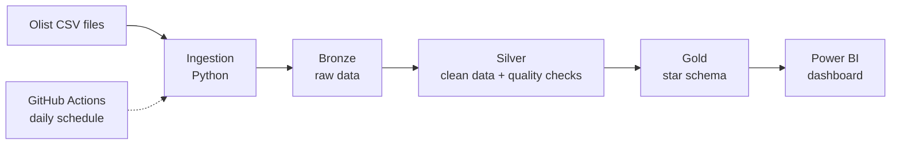

# E-commerce Data Pipeline

End-to-end data platform for a Brazilian e-commerce marketplace: ingestion, data quality, dimensional modeling, BigQuery and dbt, running every day as a **live store**.

> **Status:** in active development. See the [roadmap](#roadmap).

## What this project does

The [Olist dataset](https://www.kaggle.com/datasets/olistbr/brazilian-ecommerce) contains ~100,000 real orders from a Brazilian marketplace, spread across 9 related tables (orders, customers, products, sellers, payments, reviews, geolocation...).

Instead of analysing it as a static snapshot from 2016–2018, this pipeline **replays the data as if the store were operating today**:

- **Historical backfill:** past orders are loaded once.
- **Daily incremental loads:** new orders "arrive" every day and only the new data is processed.
- **Quality checks** run on every load before data reaches the analytics layer.

## Planned architecture



## Tech stack

| Area | Tools |
|---|---|
| Languages | Python, SQL |
| Local warehouse | DuckDB |
| Cloud warehouse | Google Cloud BigQuery |
| Transformations | dbt (bronze / silver / gold layers) |
| Orchestration | GitHub Actions |
| Consumption | Power BI |

## Roadmap

- [x] **Phase 1 — Ingestion:** load the raw CSV files into a local database and answer the first business questions with SQL.
- [ ] **Phase 2 — Data quality:** detect and handle nulls, duplicates and broken records with automated checks.
- [ ] **Phase 3 — Dimensional modeling:** star schema with fact and dimension tables.
- [ ] **Phase 4 — Cloud:** move the warehouse to BigQuery.
- [ ] **Phase 5 — dbt:** layered transformations with tests and documentation.
- [ ] **Phase 6 — Automation:** one-command pipeline with logging, error handling and a daily schedule.
- [ ] **Phase 7 — Delivery:** Power BI dashboard and full documentation.

## Data profiling findings

Before building anything, the raw data was profiled with SQL ([queries](sql/exploration/) · [source data model](docs/source_data_model.md)). Key findings that shape the next phases:

- **`customer_id` is not a customer.** It is one per order; the real person is `customer_unique_id` (96,096 people, ~3,345 orders from repeat customers).
- **Grain matters.** `order_items` has one row per product (112,650 rows for 98,666 orders) and `geolocation` has ~52 rows per zip code, so careless joins multiply rows.
- **Data quality issues.** 775 orders have no items, 8 delivered orders have no delivery date and 6 canceled orders have one (flagged in Phase 2).
- **Incomplete months.** The first and last months are almost empty; complete data runs from 2017-01 to 2018-08, the candidate range for the live-store replay.


## Data source

Data: [Brazilian E-Commerce Public Dataset by Olist](https://www.kaggle.com/datasets/olistbr/brazilian-ecommerce) (Kaggle, CC BY-NC-SA 4.0).
The raw data is **not** included in this repository. See [Getting started](#getting-started) to download it.

## Getting started

Requirements: Python 3.10+ and Git.

```bash
git clone git@github.com:jonathantorresdata/ecommerce-data-pipeline.git
cd ecommerce-data-pipeline
python3 -m venv .venv
source .venv/bin/activate
pip install -r requirements.txt
python scripts/download_data.py
```

The download script fetches the dataset from Kaggle (no account required), extracts the 9 CSV files into `data/raw/` and verifies that all of them are present. It is idempotent: running it again does nothing if the files already exist (use `--force` to download again).
