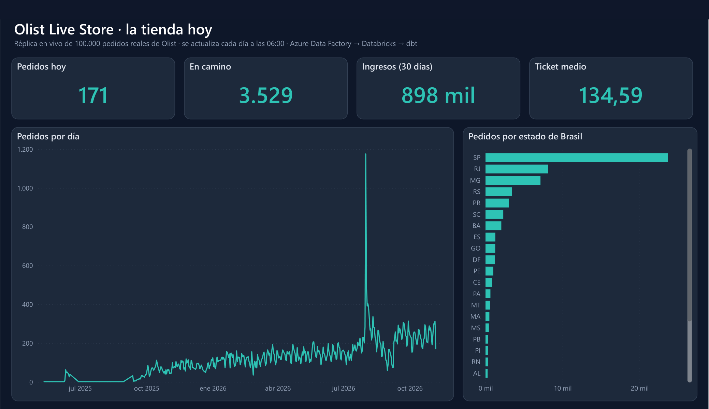
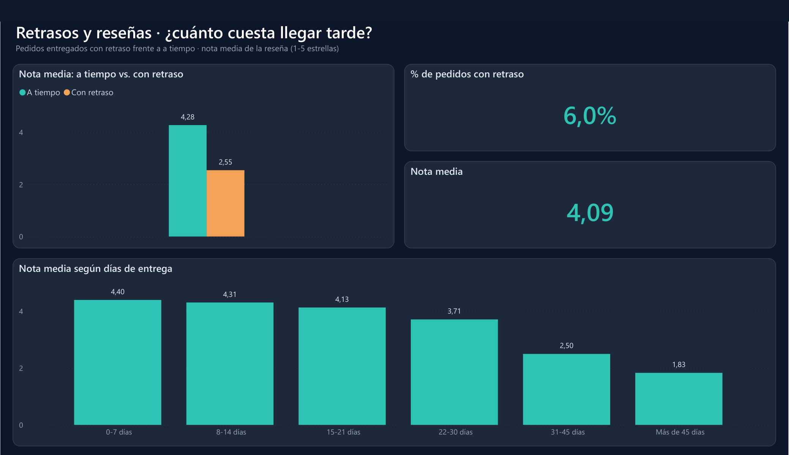
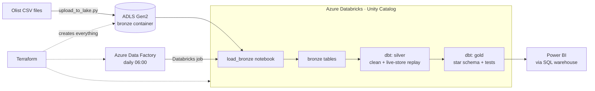

# E-commerce Data Pipeline: a live store on Azure

[](https://github.com/jonathantorresdata/ecommerce-data-pipeline/actions/workflows/ci.yml)

End-to-end data platform for a Brazilian marketplace: **100,000 real orders replayed as if the store were open today**, loaded every morning by Azure Data Factory, modelled with dbt on Databricks, tested automatically and served in Power BI. All the cloud infrastructure is Terraform.



## Key results

- **Late deliveries sink reviews:** orders delivered on time average **4.28 ★**; late orders average **2.55 ★**. Reviews fall from 4.40 ★ (delivered within a week) to 1.83 ★ (more than 45 days).
- **A store that updates itself:** every day at 06:00 the pipeline adds that day's orders and updates older ones that were shipped, delivered or reviewed (incremental merge, late-arriving data).
- **Trustworthy numbers:** 39 dbt tests and 20 local quality checks; the cloud model reproduces the local DuckDB model row for row.
- **Reproducible and cheap:** `terraform apply` builds the whole platform in minutes, `terraform destroy` removes it; serverless compute and a budget with alerts keep the cost to cents per day.



## Architecture



| Layer | What it holds | Built by |
|---|---|---|
| **Bronze** | The 9 raw CSV files as tables, plus `_source_file` and `_loaded_at` lineage columns | [databricks/load_bronze.py](databricks/load_bronze.py) |
| **Silver** | One clean table per entity: clearer names, quality flags, timestamps moved to the replayed calendar | [dbt/models/silver](dbt/models/silver) |
| **Gold** | Star schema: `fact_orders`, `fact_order_items`, `dim_customers`, `dim_products`, `dim_sellers`, `dim_date` | [dbt/models/gold](dbt/models/gold) |

## The live store

Olist covers 2016–2018. The pipeline shifts every timestamp so that 2018-03-01 lands on the store opening day (2026-11-06), and on each run it only shows what has already happened:

- Orders placed before "now" are visible; the earlier ones form the **historical backfill**.
- Events in the future are hidden: an order delivered next week is `shipped` today and becomes `delivered` on the day it arrives.
- `fact_orders` is an **incremental dbt model** (merge on `order_id`) that only processes orders whose `updated_at` changed, so late events update existing rows instead of duplicating them.
- The `as_of` variable rebuilds the store as it was on any day.

This is an honest **replay of real data**, not live data. Details: [ADR 0005](docs/adr/0005-live-store-replay.md).

## Tech stack

| Area | Tools |
|---|---|
| Languages | Python, SQL |
| Cloud | Microsoft Azure: Data Lake Storage Gen2, Databricks (Unity Catalog, Delta, serverless jobs and SQL warehouse), Data Factory |
| Transformations | dbt (dbt-databricks) |
| Infrastructure as code | Terraform (azurerm + databricks providers) |
| Local development | DuckDB |
| CI | GitHub Actions: local pipeline + quality checks, `dbt parse`, `terraform validate` |
| Consumption | Power BI (project file in [powerbi/](powerbi/), versioned as text) |

## Data quality

Decisions on every issue found while profiling are in [docs/data_quality_decisions.md](docs/data_quality_decisions.md): no row is deleted silently; issues are fixed when the fix is safe or flagged with a column otherwise.

- **dbt:** 39 tests run on every build (unique and not-null keys, relationships between facts and dimensions, accepted values, no orders from the future, joins that do not multiply rows, incremental table complete). A failing test stops the job.
- **Local:** `pipeline/check_quality.py` runs 20 checks on the DuckDB model, also on every push in CI.

## Profiling findings

Before building anything, the raw data was profiled with SQL ([queries](sql/exploration/) · [source data model](docs/source_data_model.md)):

- **`customer_id` is not a customer.** It is one per order; the real person is `customer_unique_id` (96,096 people).
- **Grain matters.** `order_items` has one row per product (112,650 rows for 98,666 orders) and `geolocation` ~52 rows per zip code, so careless joins multiply rows.
- **Quality issues.** 775 orders without items, 8 delivered orders without a delivery date and 6 canceled orders with one (flagged in silver).

Star schema grain and design decisions: [docs/gold_model.md](docs/gold_model.md).

## Architecture decisions

Six short ADRs explain the main choices: one cloud, Terraform with a service principal, keyless data lake access, dbt, the live-store replay and serverless compute. See [docs/adr](docs/adr/).

## Cost control

A budget with email alerts from day one, every resource in one resource group, no NAT gateway, a single-node interactive cluster that stops after 15 idle minutes, and serverless compute for the daily job and the SQL warehouse (auto-stop after 5 minutes). A daily run costs a few cents.

## Getting started

### Run locally (DuckDB, no cloud account needed)

Requirements: Python 3.10+ and Git.

```bash
git clone git@github.com:jonathantorresdata/ecommerce-data-pipeline.git
cd ecommerce-data-pipeline
python3 -m venv .venv
source .venv/bin/activate
pip install -r requirements.txt
python scripts/download_data.py
python pipeline/load_raw.py
python pipeline/build_silver.py
python pipeline/build_gold.py
python pipeline/check_quality.py
```

The download script fetches the dataset from Kaggle (no account required) and is idempotent.

### Run on Azure

Requirements: Terraform, Azure CLI and an Azure subscription.

```bash
# 1. Service principal for Terraform; copy appId, password and tenant into .env (see .env.example)
az ad sp create-for-rbac --name sp-terraform-ecommerce --role Owner --scopes /subscriptions/<subscription-id>

# 2. Create the infrastructure (data lake, Databricks, Unity Catalog, job, Data Factory)
set -a; source .env; set +a
terraform -chdir=infra init
terraform -chdir=infra apply

# 3. Save the new storage key in .env (without printing it) and upload the raw files
sed -i "s|^AZURE_STORAGE_ACCOUNT_KEY=.*|AZURE_STORAGE_ACCOUNT_KEY=$(terraform -chdir=infra output -raw storage_account_key)|" .env
set -a; source .env; set +a
python pipeline/upload_to_lake.py

# 4. Run the "live-store" job once (or wait for Data Factory at 06:00)
terraform -chdir=infra output job_url

# 5. Optional: run dbt from your machine against the SQL warehouse
pip install -r dbt/requirements.txt
scripts/run_dbt.sh build

# 6. Remove everything when you are done
terraform -chdir=infra destroy
```

Open [powerbi/olist_live_store.pbip](powerbi/) in Power BI Desktop and refresh; it connects to the SQL warehouse.

## Roadmap

- [x] **Phase 1 — Ingestion:** raw CSV files into a local database and first business questions in SQL.
- [x] **Phase 2 — Data quality:** nulls, duplicates and broken records handled with automated checks.
- [x] **Phase 3 — Dimensional modeling:** star schema with two fact tables and four dimensions.
- [x] **Phase 4 — Cloud:** Azure data lake and Databricks, all created with Terraform, keyless access.
- [x] **Phase 5 — dbt:** silver and gold as dbt models with 39 tests and documentation.
- [x] **Phase 6 — Automation:** live-store replay, incremental loads, daily schedule in Data Factory, CI in GitHub Actions.
- [x] **Phase 7 — Delivery:** Power BI dashboard and documentation.

## Data source

[Brazilian E-Commerce Public Dataset by Olist](https://www.kaggle.com/datasets/olistbr/brazilian-ecommerce) (Kaggle, CC BY-NC-SA 4.0). The raw data is **not** included in this repository.
