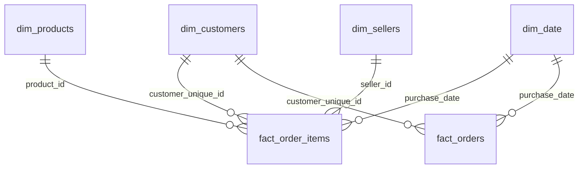

# Gold model: star schema

The `gold` layer turns the clean `silver` tables into a star schema: two fact tables in the center (what happened, with numbers) and four dimensions around them (who, what and when).

## Tables and grain

| Table | One row is | Rows |
|---|---|---|
| `fact_order_items` | one product sold within an order (price, freight) | 112,650 |
| `fact_orders` | one order (totals, delivery days, delay, review score) | 99,441 |
| `dim_customers` | one real person (`customer_unique_id`) | 96,096 |
| `dim_products` | one product | 32,951 |
| `dim_sellers` | one seller, with zip code coordinates | 3,095 |
| `dim_date` | one calendar day (2016-01-01 to 2018-12-31) | 1,096 |

## Design decisions

1. **Two fact tables, not one.** Sales live at product level, but delivery times, payments and reviews belong to the whole order. Putting order-level values on every product row would repeat them: the average review score is 4.09 per order but 4.03 if counted per item, because 9,803 orders have more than one item.
2. **Aggregate before joining.** Items, payments and reviews have several rows per order, so `fact_orders` groups each of them to one row per order before the join. Otherwise each order would be repeated once per payment or review.
3. **Customers keyed by the real person.** `customer_id` changes with every order, so `dim_customers` uses `customer_unique_id`. When a person ordered from different addresses (250 people), the address of their latest order is kept (`ROW_NUMBER` over purchase date).
4. **LEFT JOIN everywhere.** No fact row is dropped when a lookup is missing: 7 sellers have a zip code without coordinates and 775 orders have no items; they stay in the model with empty values.
5. **Checks after every build.** `pipeline/check_quality.py` verifies one row per key, that every fact row points to an existing dimension row, and that joins did not change the number of rows.

## First business answer: late deliveries hurt reviews

| Delivered orders | Orders | Average review score | Average delivery days |
|---|---|---|---|
| On time | 88,644 | 4.29 | 10.8 |
| Late | 7,826 | 2.57 | 31.5 |
