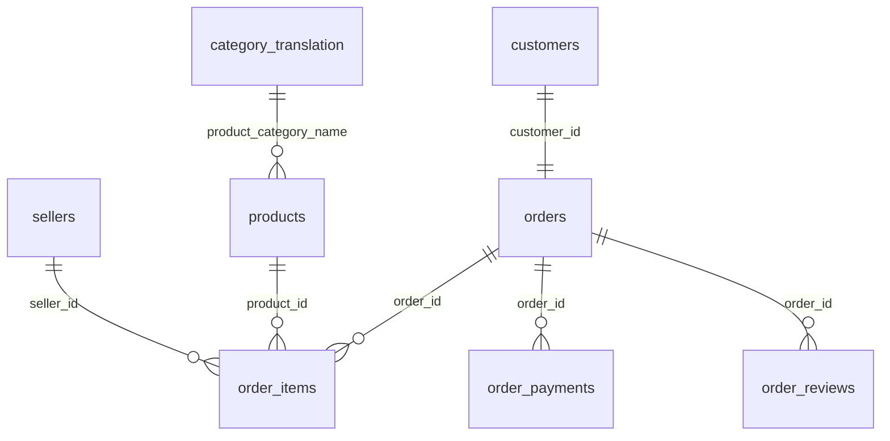

# Source data model

The Olist dataset has 9 tables. `orders` is the center: almost every table joins through `order_id`.

`geolocation` joins to `customers` and `sellers` by zip code prefix. It is not drawn because it has many rows per zip code.

## Grain: what one row represents

| Table | One row is | Rows |
|---|---|---|
| `orders` | one order | 99,441 |
| `customers` | one customer record **per order** (`customer_id`); the real person is `customer_unique_id` | 99,441 |
| `order_items` | one product within an order | 112,650 |
| `order_payments` | one payment of an order (an order can have several) | 103,886 |
| `order_reviews` | one review of an order (some `review_id` values repeat) | 99,224 |
| `products` | one product | 32,951 |
| `sellers` | one seller | 3,095 |
| `geolocation` | one coordinate of a zip code prefix (~52 rows per zip code) | 1,000,163 |
| `category_translation` | one product category (Portuguese → English) | 71 |

## Findings from profiling

- `customer_id` is one per order. Real customers are `customer_unique_id`: 96,096 people, so ~3,345 orders come from repeat customers.
- 775 orders have no items.
- 8 orders are `delivered` but have no delivery date, and 6 `canceled` orders have one.
- Orders go from 2016-09-04 to 2018-10-17, but the first and last months are almost empty. Complete months: 2017-01 to 2018-08.
- `geolocation` has many rows per zip code: it must be deduplicated before joining, or rows multiply.

Queries: [`sql/exploration/`](../sql/exploration/).
